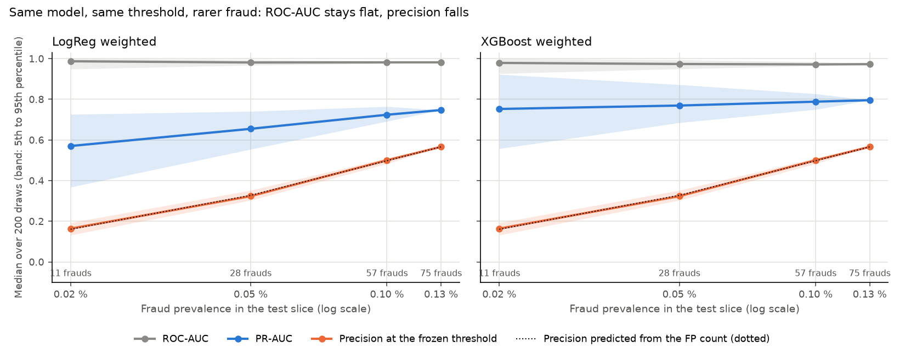
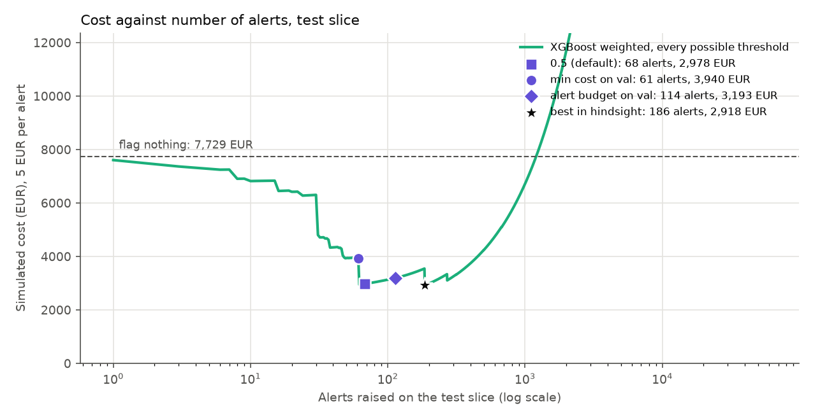
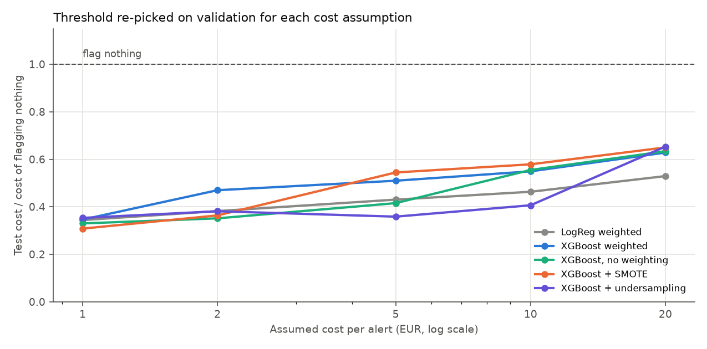
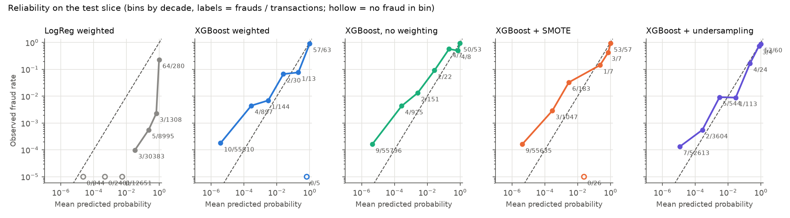
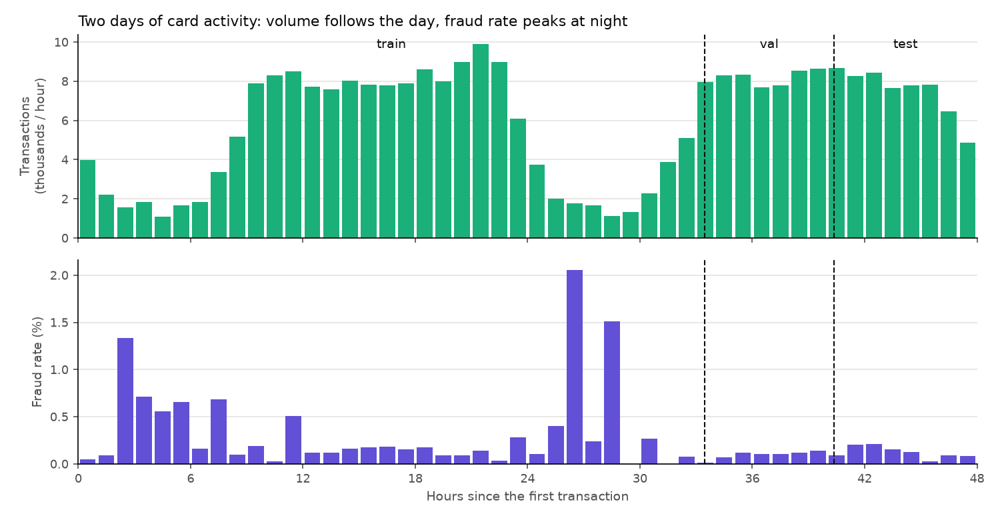

# Fraud detection under an alert budget

[](https://github.com/amine-belkacem/fraud-detection-alert-budget/actions/workflows/tests.yml)

On a credit card dataset with 0.17 % fraud, a model that never flags anything is
99.83 % accurate. This project evaluates fraud models the way a fraud team would
actually use them: how many frauds are caught when analysts can only review a
fixed number of alerts, what the errors cost in euros, and how much a test set of
75 frauds really allows one to conclude.

Everything is trained on the past and tested on the most recent transactions,
every threshold is chosen on validation before touching test, and the main
numbers come with bootstrap intervals.



## Main results

| Question | Answer (test slice, 75 frauds, 95 % bootstrap intervals) |
|---|---|
| Does accuracy mean anything here? | No. The dummy model scores 99.87 % and catches 0 fraud. |
| Best PR-AUC | 0.796 [0.709, 0.880] with class-weighted XGBoost (random ranking: 0.0013) |
| Frauds caught at 0.1 % false positive rate | 80 % [71, 88], i.e. 60 of 75 |
| Does SMOTE or undersampling help? | No measurable effect: within ±0.005 PR-AUC of plain class weighting, intervals centred on zero |
| Is XGBoost better than a weighted logistic regression? | Probably (wins 84 % of bootstrap replicates), but the PR-AUC interval of the difference still contains zero. Under stress it is clearly more robust. |
| What does a good threshold save? | The weighted logistic regression costs 10,281 EUR at threshold 0.5 and 2,928 EUR with a threshold chosen on validation. Flagging nothing costs 7,729 EUR. |
| Does the 5 EUR per alert assumption drive that? | No. From 1 to 20 EUR per alert, every model stays between 31 % and 65 % of the cost of flagging nothing. |
| What happens if fraud gets 6 times rarer? | ROC-AUC stays at 0.97 to 0.99, precision at the frozen threshold falls from 0.57 to 0.16, exactly as the false positive count predicts. |
| What would a random split have reported? | PR-AUC 0.867 instead of 0.796 for XGBoost, an optimism of 0.07 that the temporal split removes. |

### Against the success criteria set before starting

| Criterion | Target | Measured | Met |
|---|---|---|---|
| C1 PR-AUC of the best model | at least 0.70 | 0.796 [0.709, 0.880] | yes, lower bound just above |
| C2 recall at 0.1 % FPR | at least 70 % | 80 % [71, 88] | yes |
| C3 cost below "flag nothing" and "flag everything", 1 to 20 EUR per alert | every value | 31 % to 65 % of "flag nothing" | yes |
| C4 argued conclusion on resampling, with intervals | yes / no | no effect, intervals centred on zero | yes |
| C5 stress test showing ROC-AUC vs precision | figure | `figures/stress_test.png` | yes |
| C6 tests pass locally and in CI, one-command rebuild | yes | 70 tests, `python scripts/run_all.py` | yes |
| E7 full rebuild time | under 15 min | 10.1 min | yes, on an idle laptop |
| C7 inference in C on a Raspberry Pi 5 | optional | not done | no |

## Data

ULB / Worldline credit card fraud dataset: 284,807 European card transactions over
two days in September 2013, 492 of them fraudulent (0.173 %). Features V1 to V28 are
PCA components released by the data provider; only `Time` and `Amount` are in clear.
Distributed on Kaggle (mlg-ulb/creditcardfraud) under ODbL 1.0 (database) / DbCL 1.0 (contents)
licence. The CSV is not stored here:

```bash
python scripts/download_data.py
```

The script checks the SHA-256 of the file and its row and fraud counts.

Source: A. Dal Pozzolo, O. Caelen, R. A. Johnson, G. Bontempi, *Calibrating
Probability with Undersampling for Unbalanced Classification*, IEEE SSCI 2015.

## Split

Rows are cut in time order, never shuffled: the model is trained on the past and
tested on the most recent transactions, as it would be in production. Each cut is
moved to the next change of timestamp so that no second of activity lands in two sets.

| Set | Hours | Transactions | Frauds | Prevalence |
|---|---|---|---|---|
| train | 0 to 33.4 | 170,888 | 360 | 0.211 % |
| validation | 33.4 to 40.3 | 56,957 | 57 | 0.100 % |
| test | 40.3 to 48.0 | 56,962 | 75 | 0.132 % |

The fraud rate in training is twice the one in validation. A PR-AUC measured on one
set is therefore not directly comparable with one measured on another.

About duplicates: the file has 1,081 exact duplicate rows. None of them straddle a
cut (copies share the same timestamp). Another 1,209 validation and test rows have
the same features and amount as some training row at a different time, which looks
like recurring payments of 1 to 10 EUR. None of these are frauds, so I keep every row.

## First results: the accuracy trap (milestone J1)

Trained on train, evaluated once on test. Single run, no confidence intervals yet
(they come with the bootstrap in J2), so differences of a few points are not
meaningful at this stage.


| Model | Accuracy @0.5 | Recall @0.5 | Alerts @0.5 | ROC-AUC | PR-AUC | Recall @FPR 0.1 % | Cost @0.5 (EUR) |
|---|---|---|---|---|---|---|---|
| Dummy (always legit) | 99.87 % | 0 % | 0 | 0.500 | 0.0013 | 0 % | 7,729 |
| Logistic regression | 99.91 % | 49 % | 52 | 0.972 | 0.684 | 75 % | 7,133 |
| Logistic regression, class-weighted | 97.32 % | 89 % | 1,588 | 0.982 | 0.747 | 80 % | 10,281 |

What I take from it:

- The dummy model is 99.87 % accurate and catches no fraud at all. Accuracy ranks it
  above the class-weighted model, which catches 89 % of them.
- Class weighting raises recall at threshold 0.5 but floods the analysts with 1,588
  alerts. At 5 EUR per alert this costs more than letting every fraud through
  (10,281 vs 7,729 EUR). The model is not the problem, the 0.5 threshold is:
  choosing it properly is milestone J3.
- The class-weighted model's single highest score is a legitimate transaction: the
  largest one in the dataset (25,691 EUR), with a PCA component at 120 when the
  median row stays around 2. A linear model extrapolates on that kind of outlier,
  which is one reason to try trees in J2.
- With 100 alerts per 100k transactions the test slice allows 56 alerts for 75
  frauds, so no model can exceed 75 % recall under that budget. From J2 on, the main
  operating point is 200 per 100k (113 alerts) and 100 per 100k is kept as a stress case.

Reproduce with `python scripts/run_baseline.py` (CSV in `results/`).

## Trees, resampling and how much the test set can tell (milestone J2)

Models added: Isolation Forest (no labels), XGBoost with class weighting, and
XGBoost after SMOTE or random undersampling. Resampling sits inside an
imbalanced-learn pipeline, so it only ever touches training rows.

Hyperparameters were picked on the validation slice only, with a deliberately
small grid (34 trials, `results/tuning.csv`): validation holds 57 frauds, and a big
search would mostly learn those 57 rows. The resampled variants reuse the best
XGBoost trees and only tune the resampling ratio, so any gap between them comes
from the resampling itself.

Every number below comes with a 95 % interval from 1,000 stratified bootstrap
replicates of the test slice (each keeps its 75 frauds). All models are scored on
the same replicates, which allows paired comparisons.


| Model | PR-AUC [95 % CI] | Recall @FPR 0.1 % | Recall, 113 alerts | PR-AUC spread over 5 seeds (std) |
|---|---|---|---|---|
| Dummy | 0.001 | 0 % | 0 % | 0 |
| Isolation Forest | 0.065 [0.048, 0.092] | 0 % | 9 % [1, 15] | 0.003 |
| LogReg | 0.684 [0.582, 0.787] | 75 % [65, 84] | 75 % [67, 84] | 0 |
| LogReg weighted | 0.747 [0.643, 0.858] | 80 % [71, 88] | 80 % [71, 88] | 0 |
| XGBoost weighted | 0.796 [0.709, 0.880] | 80 % [71, 88] | 80 % [71, 88] | 0.003 |
| XGBoost + SMOTE | 0.792 [0.710, 0.877] | 79 % [68, 87] | 79 % [69, 87] | 0.010 |
| XGBoost + undersampling | 0.797 [0.711, 0.879] | 80 % [71, 89] | 80 % [71, 89] | 0.011 |

Paired differences in PR-AUC (`results/models_paired.csv`):

| Comparison | Mean difference | 95 % CI | Replicates where the first wins |
|---|---|---|---|
| XGBoost vs LogReg weighted | +0.041 | [-0.020, +0.122] | 84 % |
| XGBoost + SMOTE vs XGBoost | -0.004 | [-0.025, +0.017] | 37 % |
| XGBoost + undersampling vs XGBoost | +0.001 | [-0.016, +0.023] | 52 % |
| XGBoost vs Isolation Forest | +0.730 | [+0.649, +0.801] | 100 % |

What I take from it:

- **Resampling does not help here.** SMOTE and undersampling land within ±0.004
  PR-AUC of plain class weighting, with intervals centred on zero. Class weights
  get the same effect without inventing synthetic frauds or throwing data away.
- **XGBoost is probably better than the weighted logistic regression, but this test
  slice cannot prove it.** It wins 84 % of the replicates, yet the interval still
  contains zero. With 75 frauds, a gap of 0.04 PR-AUC is within the noise. Under
  the alert budget the two catch exactly the same number of frauds (60 of 75).
- **Isolation Forest is not a fraud detector on this data.** It is 50 times better
  than random (0.065 vs 0.0013 PR-AUC) but at a 0.1 % false positive rate it catches
  nothing. Fraud here is not the same thing as "unusual": many legitimate
  transactions are more atypical than the frauds.
- **All the supervised models miss the same frauds.** Of the 75 test frauds, 58
  are caught by all four supervised models and 13 by none (`scripts/missed_frauds.py`).
  Those 13 add up to 2,378 EUR, including one of 1,097 EUR. Since the models
  agree that closely, an ensemble would not help much: catching those frauds would
  take new information (merchant, card history), which the anonymised dataset
  does not provide.
- Recall at 0.1 % FPR and recall with 113 alerts come out equal for every model.
  Both operating points happen to land on the same threshold here: about 60
  frauds plus 50 to 57 false alarms.

Reproduce with `python scripts/tune.py`, then `python scripts/run_models.py`
and `python scripts/missed_frauds.py`.

## Choosing the threshold, and what it costs (milestone J3)

The threshold is picked on the validation slice, then frozen and applied to test.
Three rules, matching three ways a fraud team can state its constraint:

- **FPR cap**: bother at most 0.1 % of honest customers;
- **alert budget**: raise at most 200 alerts per 100k transactions;
- **minimum cost**: lowest simulated cost on validation (missed fraud amount + 5 EUR per alert).

Test slice, seed 0, 5 EUR per alert. "Flag nothing" costs 7,729 EUR (the sum of the
75 frauds); "flag everything" costs 284,810 EUR.

| Model | Rule (chosen on val) | Alerts on test | Frauds caught | Cost (EUR) |
|---|---|---|---|---|
| LogReg weighted | threshold 0.5 | 1,588 | 67 | 10,281 |
| LogReg weighted | FPR 0.1 % | 106 | 60 | 2,928 |
| XGBoost weighted | FPR 0.1 % | 106 | 60 | 3,153 |
| XGBoost weighted | alert budget | 114 | 60 | 3,193 |
| XGBoost weighted | minimum cost | 61 | 56 | 3,940 |
| XGBoost, no weighting | FPR 0.1 % | 105 | 60 | 2,923 |
| XGBoost + undersampling | minimum cost | 74 | 58 | 2,771 |

Full table with every model and rule, plus the best threshold in hindsight:
`results/thresholds_test.csv`.



What I take from it:

- **The threshold matters more than the model.** The weighted logistic regression
  goes from 10,281 EUR at 0.5 to 2,928 EUR with the FPR rule, 72 % less. Once
  the threshold is set properly, every model lands between 2,770 and 4,210 EUR.
- **"Minimise the cost on validation" sounds like the right rule and is the least
  reliable one.** The cost curve is a staircase driven by a few large frauds.
  For XGBoost, the rule stops at 61 alerts; the 62nd transaction in the ranking is
  a 996 EUR fraud. Validation holds 57 frauds whose amounts have little to do
  with the test ones, so the minimum moves from one slice to the next. The FPR and
  budget rules only depend on the ranking and transfer better.
- **Thresholds do not transfer exactly.** The budget rule picks 113 alerts on
  validation, and the same threshold raises 114 to 123 on test, up to 9 % over
  budget. The score distribution shifts between days; a real system would have
  to recalibrate the threshold on recent traffic.
- **The cost of one model on one slice is very uncertain.** With 1,000 bootstrap
  replicates, XGBoost + undersampling costs 2,771 EUR [812, 5,598], a 64 % saving
  over flagging nothing [35 %, 88 %] (`results/thresholds_cost_ci.csv`). The
  intervals of all five models overlap widely, so I do not rank them by cost.
  The lowest lower bound on the saving is still 17 % (XGBoost + SMOTE): every
  model beats doing nothing.

### Is the 5 EUR per alert assumption carrying the result?

For each cost per alert from 1 to 20 EUR, the threshold is re-picked on validation
(minimum-cost rule) and applied to test.



Every model stays between 31 % and 65 % of the cost of flagging nothing across the
whole range, and flagging everything costs 57,000 to 1.1 million EUR. The
conclusion "a model with a tuned threshold beats both naive strategies" holds
however the analyst time is priced within that range.

### Calibration



| Model | Brier score | Mean predicted probability | Observed fraud rate |
|---|---|---|---|
| LogReg weighted | 0.0241 | 0.0737 | 0.0013 |
| XGBoost weighted | 0.00046 | 0.0012 | 0.0013 |
| XGBoost, no weighting | 0.00044 | 0.0011 | 0.0013 |
| XGBoost + SMOTE | 0.00045 | 0.0011 | 0.0013 |
| XGBoost + undersampling | 0.00047 | 0.0013 | 0.0013 |

- The weighted logistic regression is badly overconfident: on average it predicts
  56 times the real fraud rate, and transactions it scores between 0.5 and 0.9
  turn out to be fraud 0.23 % of the time. Its ranking is fine (J2), but its
  scores cannot be read as probabilities.
- The XGBoost variants are reliable at the top: transactions scored above 0.9
  are fraud 88 % to 94 % of the time. At the bottom they are too sure of
  themselves: the 52,600 to 55,800 transactions scored below 0.0001 still contain
  7 to 10 frauds.
- Between weighting, SMOTE and undersampling I see no calibration difference I
  could defend: the middle bins hold fewer than 30 transactions each. The
  dataset's own authors show that undersampling biases probabilities (Dal Pozzolo
  et al., 2015); with 75 test frauds that effect stays inside the noise here.

Reproduce with `python scripts/run_thresholds.py` (needs
`results/best_params.json` from `scripts/tune.py`).

## Stress test and drift (milestone J4)

### Same model, same threshold, rarer fraud

The test slice keeps all of its legitimate transactions and only a random subset
of its 75 frauds, drawn 200 times per level. The threshold is the FPR-0.1 % one
chosen on validation in J3, unchanged. Only the base rate moves. The figure is
the one at the top of this page.

| Prevalence | Frauds kept | ROC-AUC (XGBoost) | PR-AUC (XGBoost) | PR-AUC (LogReg w.) | Precision at the frozen threshold |
|---|---|---|---|---|---|
| 0.13 % (as is) | 75 | 0.973 | 0.796 | 0.747 | 0.57 |
| 0.10 % | 57 | 0.972 | 0.788 | 0.724 | 0.50 |
| 0.05 % | 28 | 0.974 | 0.769 | 0.655 | 0.32 |
| 0.02 % | 11 | 0.979 | 0.752 | 0.570 | 0.16 |

Medians over 200 draws; 5th to 95th percentiles in `results/stress_test_summary.csv`.

- **ROC-AUC does not see the base rate.** It compares one fraud with one legitimate
  transaction at a time, so removing frauds leaves it between 0.97 and 0.99. A
  dashboard showing only ROC-AUC would report the same model as equally good at
  every level.
- **Precision collapses, and it is predictable.** Both models flag 46 legitimate
  transactions at that threshold, whatever the number of frauds. True positives
  shrink with the frauds, false positives do not: with 11 frauds,
  0.8 x 11 / (0.8 x 11 + 46) = 0.16. The dotted line on the figure is that
  formula; it sits on top of the measured medians. At 0.02 % prevalence, 5 alerts
  out of 6 would be false.
- **PR-AUC separates the two models where ROC-AUC could not.** XGBoost loses 0.04
  PR-AUC from 0.13 % to 0.02 %, the logistic regression loses 0.18. XGBoost puts
  more frauds at the very top of its ranking, above every legitimate transaction,
  and that part of the curve does not depend on how many legitimate rows there
  are. This is the clearest gap between the two models in the whole project, and
  it only shows up under stress.

### Random split vs temporal split

Same model, same set sizes (60 % train, 20 % test), only the assignment of rows
changes. Five random stratified splits against the temporal one.

| Model | Temporal split PR-AUC | Random split PR-AUC (mean ± std, 5 splits) |
|---|---|---|
| LogReg weighted | 0.747 | 0.747 ± 0.043 |
| XGBoost weighted | 0.796 | 0.867 ± 0.022 |

All five random splits give XGBoost a higher score than the temporal split (0.843 to
0.902). A random split mixes transactions from the same hours into train and test,
and a flexible model can exploit that proximity; the linear model barely can.
Exact duplicates do not explain the gap: a random split puts 249 to 272 test
rows next to an identical copy in training, but only 3 to 8 of them are frauds
(`results/split_comparison.csv`). Reporting the random-split number would have
added 0.07 PR-AUC that would not survive deployment.

### What changes between the two days



- Volume follows a daily cycle with two low-activity windows, most likely nights.
  The dataset does not give the clock time, so "night" is my reading of the volume.
- Fraud concentrates in those windows: over hours 0 to 7 and 24 to 31, 156 frauds in
  35,278 transactions (0.44 %), against 0.13 % the rest of the time
  (computed from `results/hourly_activity.csv`). The single worst hour reaches 2.1 %.
- Both night windows fall in the training slice, while the test slice (hours 40 to
  48) covers an evening. This explains the base rates seen in J1: 0.21 % in train,
  0.13 % in test.

**Adversarial validation.** A classifier trained to tell test rows from training
rows, on the same 29 features the fraud models use, reaches a ROC-AUC of 0.956
(3-fold CV). Against the same clock hours one day earlier it reaches 0.997: the
features alone identify the day.
The "anonymised" PCA components carry a time signal: V3 on its own tells train
from test with a ROC-AUC of 0.77 (its values are lower on the test slice) and
correlates at -0.42 with `Time` (`results/feature_drift.csv`).

So the feature distribution shifts strongly from one day to the next, yet the
fraud models keep a PR-AUC of 0.80 on the next day. What separates fraud from
legitimate traffic seems to be more stable than the traffic itself. With two days
of data I cannot say how long that holds; that is the main limit of this dataset
for any claim about production.

Reproduce with `python scripts/run_stress.py` and `python scripts/run_drift.py`.
Time per script: `results/run_all_timing.csv`.

## How to reproduce

```bash
git clone https://github.com/amine-belkacem/fraud-detection-alert-budget
cd fraud-detection-alert-budget
python -m venv .venv
.venv/Scripts/activate          # Windows; on Linux/macOS: source .venv/bin/activate
pip install -r requirements.txt
python scripts/run_all.py
```

`run_all.py` downloads and checks the dataset, then rebuilds every CSV in
`results/` and every figure in `figures/`. On my laptop (AMD Ryzen 3 7320U, 8 GB of RAM,
Python 3.15) the whole chain took 10.1 minutes in the run recorded in
`results/run_all_timing.csv`. The same scripts ran up to about twice as slow
in earlier runs while the laptop was busy with other work, so treat that time
as a best case. All randomness is seeded: rerunning the chain reproduced every
result file and figure identically, except the training times stored in
`results/tuning.csv`.

## Tests

```bash
pytest -v
```

70 tests, mostly on hand-computed cases: every expected value is worked out in a
comment next to the assertion (metrics, cost, thresholds, bootstrap, split,
calibration bins, stress-test helpers). Before trusting a test I break its
expected value on purpose and check that it fails with an `ECHEC` message
giving the value obtained and the one expected (messages are in French). The
tests run on synthetic data, so the CI (GitHub Actions, Python 3.12) never
downloads the dataset; it also runs pyflakes.

## Limits

- **Two days of data.** The test slice is one evening. I cannot say how the models
  or the chosen thresholds would hold over weeks, and the drift analysis shows the
  features change a lot from one day to the next.
- **75 test frauds.** Most differences between good models are inside the noise,
  which is why I report intervals and paired comparisons rather than a ranking.
- **Anonymised features.** V1 to V28 are PCA components chosen by the data
  provider. No feature engineering on merchant, card history or location is
  possible, and the 13 frauds missed by every model would probably need exactly that.
- **The cost model is a simplification.** A missed fraud costs its amount, an alert
  costs 5 EUR of analyst time. Chargebacks, customer churn after a false alarm, or
  fraud that grows when undetected are not modelled. The sensitivity analysis
  covers the alert cost, not the shape of the model.
- **Small validation set.** 57 frauds decide the hyperparameters and the thresholds.
  The grid was kept small on purpose, and the minimum-cost threshold rule
  visibly overfits it.

## Repository layout

```
src/fraudbudget/   data checks, temporal split, metrics, models, thresholds,
                   bootstrap, calibration, stress-test helpers, plotting palette
scripts/           one script per milestone + run_all.py
tests/             pytest suite (synthetic data)
results/           every CSV quoted in this README
figures/           every figure, generated by the scripts
```

## Possible next step

Compile the XGBoost model to C and measure inference latency and memory on a
Raspberry Pi 5 (criterion C7 of the original plan), with a test checking that
the C scores match Python's.

## Licence and data

Code under the MIT licence. The dataset is not redistributed here; see the Data
section above for its source and licence.
