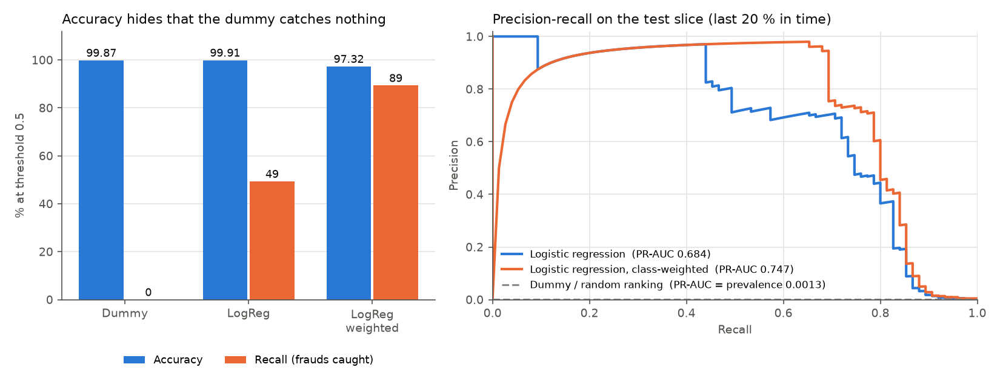
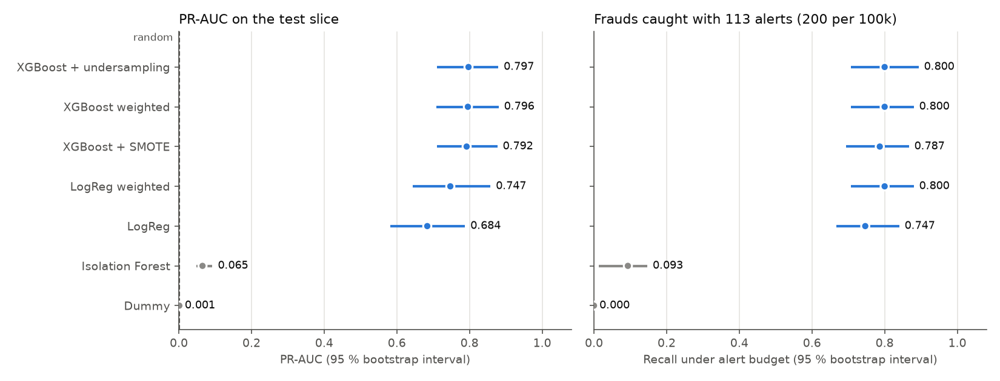

# Fraud detection under an alert budget

Work in progress. This repository evaluates credit card fraud models the way a bank
would use them: how many frauds get caught when analysts can only review a fixed
number of alerts, and what the errors cost in euros. Accuracy is not used as a
criterion, because on this dataset a model that never flags anything already
scores 99.83 %.

## Data

ULB / Worldline credit card fraud dataset: 284,807 European card transactions over
two days in September 2013, 492 of them fraudulent (0.173 %). Features V1 to V28 are
PCA components released by the data provider; only `Time` and `Amount` are in clear.
Distributed on Kaggle (mlg-ulb/creditcardfraud) under ODbL 1.0 (database) / DbCL 1.0 (contents)
licence. The CSV is not stored here:

```bash
python scripts/download_data.py
```

The script checks the SHA-256 of the file and its row and fraud counts.

Source: A. Dal Pozzolo, O. Caelen, R. A. Johnson, G. Bontempi, *Calibrating
Probability with Undersampling for Unbalanced Classification*, IEEE SSCI 2015.

## Split

Rows are cut in time order, never shuffled: the model is trained on the past and
tested on the most recent transactions, as it would be in production. Each cut is
moved to the next change of timestamp so that no second of activity lands in two sets.

| Set | Hours | Transactions | Frauds | Prevalence |
|---|---|---|---|---|
| train | 0 to 33.4 | 170,888 | 360 | 0.211 % |
| validation | 33.4 to 40.3 | 56,957 | 57 | 0.100 % |
| test | 40.3 to 48.0 | 56,962 | 75 | 0.132 % |

The fraud rate in training is twice the one in validation. A PR-AUC measured on one
set is therefore not directly comparable with one measured on another.

About duplicates: the file has 1,081 exact duplicate rows. None of them straddle a
cut (copies share the same timestamp). Another 1,209 validation and test rows have
the same features and amount as some training row at a different time, which looks
like recurring payments of 1 to 10 EUR. None of these are frauds, so I keep every row.

## First results: the accuracy trap (milestone J1)

Trained on train, evaluated once on test. Single run, no confidence intervals yet
(they come with the bootstrap in J2), so differences of a few points are not
meaningful at this stage.



| Model | Accuracy @0.5 | Recall @0.5 | Alerts @0.5 | ROC-AUC | PR-AUC | Recall @FPR 0.1 % | Cost @0.5 (EUR) |
|---|---|---|---|---|---|---|---|
| Dummy (always legit) | 99.87 % | 0 % | 0 | 0.500 | 0.0013 | 0 % | 7,729 |
| Logistic regression | 99.91 % | 49 % | 52 | 0.972 | 0.684 | 75 % | 7,133 |
| Logistic regression, class-weighted | 97.32 % | 89 % | 1,588 | 0.982 | 0.747 | 80 % | 10,281 |

What I take from it:

- The dummy model is 99.87 % accurate and catches no fraud at all. Accuracy ranks it
  above the class-weighted model, which catches 89 % of them.
- Class weighting raises recall at threshold 0.5 but floods the analysts with 1,588
  alerts. At 5 EUR per alert this costs more than letting every fraud through
  (10,281 vs 7,729 EUR). The model is not the problem, the 0.5 threshold is:
  choosing it properly is milestone J3.
- The class-weighted model's single highest score is a legitimate transaction: the
  largest one in the dataset (25,691 EUR), with a PCA component at 120 when the
  median row stays around 2. A linear model extrapolates on that kind of outlier,
  which is one reason to try trees in J2.
- With 100 alerts per 100k transactions the test slice allows 56 alerts for 75
  frauds, so no model can exceed 75 % recall under that budget. From J2 on, the main
  operating point is 200 per 100k (113 alerts) and 100 per 100k is kept as a stress case.

Reproduce with `python scripts/run_baseline.py` (CSV in `results/`).

## Trees, resampling and how much the test set can tell (milestone J2)

Models added: Isolation Forest (no labels), XGBoost with class weighting, and
XGBoost after SMOTE or random undersampling. Resampling sits inside an
imbalanced-learn pipeline, so it only ever touches training rows.

Hyperparameters were picked on the validation slice only, with a deliberately
small grid (34 trials, `results/tuning.csv`): validation holds 57 frauds, and a big
search would mostly learn those 57 rows. The resampled variants reuse the best
XGBoost trees and only tune the resampling ratio, so any gap between them comes
from the resampling itself.

Every number below comes with a 95 % interval from 1,000 stratified bootstrap
replicates of the test slice (each keeps its 75 frauds). All models are scored on
the same replicates, which allows paired comparisons.



| Model | PR-AUC [95 % CI] | Recall @FPR 0.1 % | Recall, 113 alerts | PR-AUC spread over 5 seeds (std) |
|---|---|---|---|---|
| Dummy | 0.001 | 0 % | 0 % | 0 |
| Isolation Forest | 0.065 [0.048, 0.092] | 0 % | 9 % [1, 15] | 0.003 |
| LogReg | 0.684 [0.582, 0.787] | 75 % [65, 84] | 75 % [67, 84] | 0 |
| LogReg weighted | 0.747 [0.643, 0.858] | 80 % [71, 88] | 80 % [71, 88] | 0 |
| XGBoost weighted | 0.796 [0.709, 0.880] | 80 % [71, 88] | 80 % [71, 88] | 0.003 |
| XGBoost + SMOTE | 0.792 [0.710, 0.877] | 79 % [68, 87] | 79 % [69, 87] | 0.010 |
| XGBoost + undersampling | 0.797 [0.711, 0.879] | 80 % [71, 89] | 80 % [71, 89] | 0.011 |

Paired differences in PR-AUC (`results/models_paired.csv`):

| Comparison | Mean difference | 95 % CI | Replicates where the first wins |
|---|---|---|---|
| XGBoost vs LogReg weighted | +0.041 | [-0.020, +0.122] | 84 % |
| XGBoost + SMOTE vs XGBoost | -0.004 | [-0.025, +0.017] | 37 % |
| XGBoost + undersampling vs XGBoost | +0.001 | [-0.016, +0.023] | 52 % |
| XGBoost vs Isolation Forest | +0.730 | [+0.649, +0.801] | 100 % |

What I take from it:

- **Resampling does not help here.** SMOTE and undersampling land within ±0.004
  PR-AUC of plain class weighting, with intervals centred on zero. Class weights
  get the same effect without inventing synthetic frauds or throwing data away.
- **XGBoost is probably better than the weighted logistic regression, but this test
  slice cannot prove it.** It wins 84 % of the replicates, yet the interval still
  contains zero. With 75 frauds, a gap of 0.04 PR-AUC is within the noise. Under
  the alert budget the two catch exactly the same number of frauds (60 of 75).
- **Isolation Forest is not a fraud detector on this data.** It is 50 times better
  than random (0.065 vs 0.0013 PR-AUC) but at a 0.1 % false positive rate it catches
  nothing. Fraud here is not the same thing as "unusual": many legitimate
  transactions are more atypical than the frauds.
- **All the supervised models miss the same frauds.** Of the 75 test frauds, 58
  are caught by all four supervised models and 13 by none (`scripts/missed_frauds.py`).
  Those 13 add up to 2,378 EUR, including one of 1,097 EUR. Since the models
  agree that closely, an ensemble would not help much: catching those frauds would
  take new information (merchant, card history), which the anonymised dataset
  does not provide.
- Recall at 0.1 % FPR and recall with 113 alerts come out equal for every model.
  Both operating points happen to land on the same threshold here: about 60
  frauds plus 50 to 57 false alarms.

Reproduce with `python scripts/tune.py` (about 4 min), then
`python scripts/run_models.py` (about 7 min on my laptop) and
`python scripts/missed_frauds.py`.

## Tests

```bash
pip install -r requirements.txt
pytest -v
```

The unit tests run on synthetic data, so the CI never downloads the dataset.
